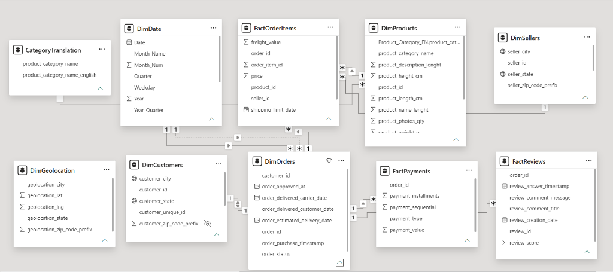
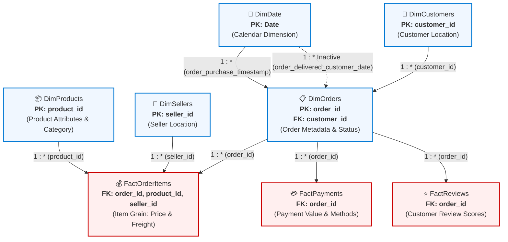
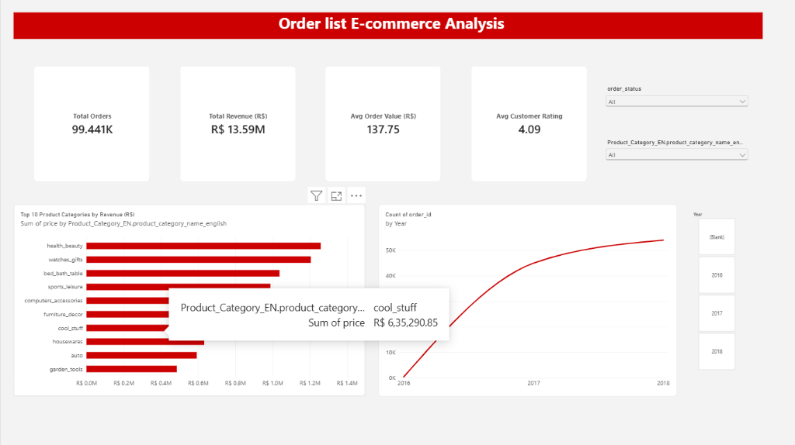
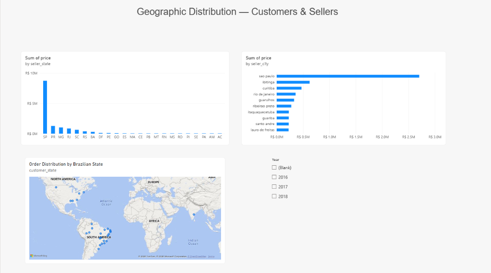
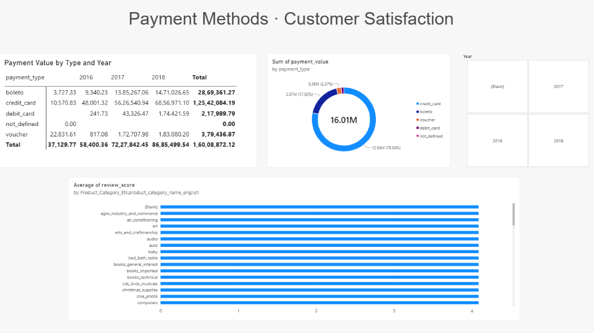

# 📊 Olist Brazilian E-Commerce Analytics — Data Modeling & Star Schema Multi-Page BI Report


[](https://drive.google.com/file/d/1Thed4dJfj63LN1VS3UEtvk5PEMAUu6lS/view?usp=drive_link)


---

## 📌 Project Overview & Quick Reference

[](https://drive.google.com/file/d/1Thed4dJfj63LN1VS3UEtvk5PEMAUu6lS/view?usp=drive_link)

| Attribute | Project Specification |
| :--- | :--- |
| **Project Title** | **Olist Brazilian E-Commerce Analytics — Data Modeling & Star Schema Multi-Page Power BI Report** |
| **Challenge / Course** | Power BI Practical Project 3 (PR 3) — Weekly Task |
| **Kaggle Dataset URL** | 🌐 **[Brazilian E-Commerce Public Dataset by Olist (Kaggle)](https://www.kaggle.com/datasets/olistbr/brazilian-ecommerce)** |
| **Project Recording Link** | [](https://drive.google.com/file/d/1Thed4dJfj63LN1VS3UEtvk5PEMAUu6lS/view?usp=drive_link) |
| **Primary Data Model** | Multi-Fact Constellation (Galaxy Schema) with Star Core |
| **Report Pages** | 3 Pages (Sales Overview, Geographic Analysis, Payments & Reviews) |
| **Tools Used** | Power BI Desktop, Power Query (M Language), DAX, Kaggle, Draw.io / Excalidraw |

---

## 🛠️ Tools & Technologies Used

* **[Power BI Desktop](https://powerbi.microsoft.com/desktop/)**: Enterprise data modeling, VertiPaq engine optimization, custom analytical hierarchies, interactive visuals, and report layout design.
* **[Power Query (M Language)](https://learn.microsoft.com/power-query/)**: Extraction of 9 relational datasets, Left Outer Join transformation for product category translation, query merging, and programmatic calendar generation.
* **[DAX (Data Analysis Expressions)](https://learn.microsoft.com/dax/)**: Measure formulation (`AVERAGEX`, `CALCULATE`, `SUM`, `COUNTROWS`), filter context manipulation, and inactive relationship activation via `USERELATIONSHIP()`.
* **[Kaggle E-Commerce Dataset](https://www.kaggle.com/datasets/olistbr/brazilian-ecommerce)**: Public anonymized dataset of 100k Brazilian e-commerce orders (2016–2018).
* **[Mermaid.js & Markdown](https://mermaid.js.org/)**: Visual schema flow architecture, technical documentation, and GitHub formatting.
* **[Drawing / Whiteboard Tool (Excalidraw / Draw.io / Paper)](https://excalidraw.com/)**: Pre-modeling conceptual sketching of the Star Schema before relationship creation in Power BI Desktop.

---

## 📑 Table of Contents
1. [Project Overview & Quick Reference](#-project-overview--quick-reference)
2. [Tools & Technologies Used](#️-tools--technologies-used)
3. [Dataset Architecture & Normalization (3NF)](#-dataset-architecture--normalization-3nf)
4. [ETL & Data Transformation (Power Query)](#-etl--data-transformation-power-query)
5. [Star Schema & Galaxy Model Architecture](#-star-schema--galaxy-model-architecture)
   - [Hand-Drawn / Conceptual Schema Plan](#1-hand-drawn--conceptual-schema-plan)
   - [Power BI Model View Screenshot](#2-power-bi-model-view-screenshot)
   - [Interactive Architecture Flowchart (Mermaid)](#3-interactive-architecture-flowchart-mermaid)
6. [Comprehensive 7-Relationship Documentation Matrix](#-comprehensive-7-relationship-documentation-matrix)
7. [DimDate Calendar Table Implementation (M-Code)](#-dimdate-calendar-table-implementation-m-code)
8. [Star Schema vs. Snowflake Extension & Inactive Relationships](#-star-schema-vs-snowflake-extension--inactive-relationships)
9. [Multi-Fact Dynamics & Filter Context Propagation](#-multi-fact-dynamics--filter-context-propagation)
10. [Analytical Drill-Down Hierarchies](#-analytical-drill-down-hierarchies)
11. [DAX Formulations & Key Performance Indicators (KPIs)](#-dax-formulations--key-performance-indicators-kpis)
12. [Multi-Page Dashboard Architecture & Visual Design](#-multi-page-dashboard-architecture--visual-design)
    - [Page 1: Sales Overview](#page-1-sales-overview)
    - [Page 2: Geographic Analysis](#page-2-geographic-analysis)
    - [Page 3: Payments & Reviews](#page-3-payments--reviews)
13. [UI/UX Design System & Theme Specifications](#-uiux-design-system--theme-specifications)
14. [Model Validation & Quality Assurance Checklist](#-model-validation--quality-assurance-checklist)
15. [Business Insights & Analytical Findings](#-business-insights--analytical-findings)
16. [How to Run & Recreate the Project](#-how-to-run--recreate-the-project)
17. [📸 Visual Project Showcase & Task-by-Task Screenshot Analysis](#-visual-project-showcase--task-by-task-screenshot-analysis)
    - [Exhibit 1: Model View & Relationship Architecture (Tasks 2, 4, 5, 6, 7.1)](#exhibit-1-model-view--relationship-architecture-tasks-2-4-5-6-71)
    - [Exhibit 2: Dashboard Page 1 — Sales Overview (Tasks 9, 10, 11.1)](#exhibit-2-dashboard-page-1--sales-overview-tasks-9-10-111)
    - [Exhibit 3: Dashboard Page 2 — Geographic Analysis (Tasks 7.4, 8.3, 8.4, 9.7, 11.2)](#exhibit-3-dashboard-page-2--geographic-analysis-tasks-74-83-84-97-112)
    - [Exhibit 4: Dashboard Page 3 — Payments & Customer Reviews (Tasks 6, 7.2, 7.3, 9.8, 11.3)](#exhibit-4-dashboard-page-3--payments--customer-reviews-tasks-6-72-73-98-113)

---

## 🗄️ Dataset Architecture & Normalization (3NF)

The dataset is hosted publicly on Kaggle:
👉 **[Kaggle Dataset: Brazilian E-Commerce Public Dataset by Olist](https://www.kaggle.com/datasets/olistbr/brazilian-ecommerce)**

It contains 9 separate relational CSV files representing transactions between 2016 and 2018:

```
olist_ecommerce/
├── olist_order_items_dataset.csv       --> Central Fact Table (Item Grain)
├── olist_orders_dataset.csv            --> Core Order Context Dimension
├── olist_customers_dataset.csv         --> Customer Geographic Dimension
├── olist_products_dataset.csv          --> Product Dimension
├── olist_sellers_dataset.csv           --> Seller Geographic Dimension
├── olist_order_payments_dataset.csv    --> Multi-Fact Payment Transactions
├── olist_order_reviews_dataset.csv     --> Multi-Fact Customer Feedback
├── olist_geolocation_dataset.csv       --> Zip Code Mapping (Reference)
└── product_category_name_translation.csv --> Portuguese-to-English Mapping
```

### Database Normalization: 3NF vs. Denormalized Flat Files
* **Why Olist is 3NF (Third Normal Form)**:
  * Each table describes **one discrete business entity** (`Orders`, `Customers`, `Products`, `Sellers`).
  * No redundant repeated columns (e.g., customer address is stored once in `DimCustomers`, not duplicated across every order item).
  * Entities are linked strictly through Primary Keys (PK) and Foreign Keys (FK).
* **Flat File vs. Relational Comparison**:
  * A single flat CSV containing all columns would result in massive row duplication (e.g., customer details and product names repeated millions of times), causing high memory consumption and update anomalies.
  * In Power BI, we ingest this 3NF structure and organize it into a **Star Schema** to optimize the in-memory columnar VertiPaq engine.

---

## 🔄 ETL & Data Transformation (Power Query)

1. **Data Ingestion**: All 9 CSVs loaded into Power BI Desktop via `Home → Get Data → Text/CSV`.
2. **Dimension Merge (Translation)**:
   * Merged `olist_products_dataset` with `product_category_name_translation` via **Left Outer Join** on `product_category_name`.
   * Expanded `product_category_name_english` and renamed it to **`Product_Category_EN`**.
   * Disabled `Enable Load` on `CategoryTranslation` since its data is fully encapsulated within `DimProducts`.
3. **Canonical Table Renaming**:

| Original CSV File Name | Transformed Model Name | Table Type | Entity / Grain |
| :--- | :--- | :--- | :--- |
| `olist_order_items_dataset.csv` | **FactOrderItems** | Central Fact | 1 row per order item (price, freight) |
| `olist_orders_dataset.csv` | **DimOrders** | Dimension | 1 row per order (order status, timestamps) |
| `olist_customers_dataset.csv` | **DimCustomers** | Dimension | Customer ID, zip, city, state |
| `olist_products_dataset.csv` | **DimProducts** | Dimension | Product ID, attributes, English category |
| `olist_sellers_dataset.csv` | **DimSellers** | Dimension | Seller ID, zip, city, state |
| `olist_order_payments_dataset.csv` | **FactPayments** | Fact Table | Payment type, installments, payment value |
| `olist_order_reviews_dataset.csv` | **FactReviews** | Fact Table | Review score (1–5), review timestamps |
| `olist_geolocation_dataset.csv` | **DimGeolocation** | Dimension | Latitude/longitude spatial lookup |
| `product_category_name_translation.csv` | **CategoryTranslation** | Staging | Merged into `DimProducts` (Load Disabled) |

4. **Technical Key Hygiene**:
   * Hidden from Report View: `FactOrderItems[order_item_id]`, `DimCustomers[customer_zip_code_prefix]`, `DimSellers[seller_zip_code_prefix]`, `DimProducts[product_name_lenght]`, `DimProducts[product_description_lenght]`.

---

## 📐 Star Schema & Galaxy Model Architecture

### 1. Hand-Drawn / Conceptual Schema Plan
*(Task 2.1: Conceptual planning on paper / digital canvas prior to building relationships in Power BI)*

```
                       +-------------------------+
                       |         DimDate         |
                       |  PK: Date               |
                       +-------------------------+
                                    | 1
                                    |
                                    | *
+-------------------------+    +-------------------------+    +-------------------------+
|      DimCustomers       |    |        DimOrders        |    |       DimProducts       |
|  PK: customer_id        |<---|  PK: order_id           |    |  PK: product_id         |
+-------------------------+ 1  |  FK: customer_id        |    +-------------------------+
                               +-------------------------+                 | 1
                                    | 1           | 1                      |
                                    |             |                        |
                   +----------------+             +---------+              |
                   | *                                      | *            | *
      +-------------------------+              +-------------------------+ |
      |      FactPayments       |              |     FactOrderItems      |<+
      |  FK: order_id           |              |  FK: order_id           |
      |  payment_value          |              |  FK: product_id         |
      +-------------------------+              |  FK: seller_id          |
                   |                           |  price, freight_value   |
                   |                           +-------------------------+
                   |                                        | *
                   | *                                      |
      +-------------------------+                           | 1
      |       FactReviews       |              +-------------------------+
      |  FK: order_id           |              |       DimSellers        |
      |  review_score           |              |  PK: seller_id          |
      +-------------------------+              +-------------------------+
```

---

### 2. Power BI Model View Screenshot
*(Task 7.1: Model layout in Power BI Desktop arranged in a clean star/galaxy structure)*



---

### 3. Interactive Architecture Flowchart (Mermaid)



---

## 🔗 Comprehensive 7-Relationship Documentation Matrix

Here is the complete documentation of **all 7 active core relationships** (plus 1 inactive fulfillment relationship) configured in Power BI Desktop:

| # | From Table (Many Side `*`) | From Column (Foreign Key) | To Table (One Side `1`) | To Column (Primary Key) | Cardinality | Cross-Filter Direction | Status | Purpose & Business Context |
| :-: | :--- | :--- | :--- | :--- | :-: | :-: | :-: | :--- |
| **1** | `FactOrderItems` | `order_id` | `DimOrders` | `order_id` | **Many-to-One (`*:1`)** | Single | **Active** | Links individual item transactions and price/freight facts to order metadata. |
| **2** | `FactOrderItems` | `product_id` | `DimProducts` | `product_id` | **Many-to-One (`*:1`)** | Single | **Active** | Slices product revenue and freight by product attributes and English categories. |
| **3** | `FactOrderItems` | `seller_id` | `DimSellers` | `seller_id` | **Many-to-One (`*:1`)** | Single | **Active** | Enables merchant performance tracking, seller state revenue, and city breakdowns. |
| **4** | `DimOrders` | `customer_id` | `DimCustomers` | `customer_id` | **Many-to-One (`*:1`)** | Single | **Active** | Connects orders to customer geographic origins (Snowflake extension). |
| **5** | `DimOrders` | `order_purchase_timestamp` | `DimDate` | `Date` | **Many-to-One (`*:1`)** | Single | **Active** | Primary chronological timeline linking order purchase moments to the calendar dimension. |
| **6** | `FactPayments` | `order_id` | `DimOrders` | `order_id` | **Many-to-One (`*:1`)** | Single | **Active** | Associates payment installments and payment values to individual orders in the galaxy schema. |
| **7** | `FactReviews` | `order_id` | `DimOrders` | `order_id` | **Many-to-One (`*:1`)** | Single | **Active** | Connects customer review scores (1–5) and feedback timestamps to orders. |
| *8* | `DimOrders` | `order_delivered_customer_date` | `DimDate` | `Date` | **Many-to-One (`*:1`)** | Single | *Inactive* | Secondary fulfillment relationship; activated in DAX using `USERELATIONSHIP()` for delivery cycle analysis. |

> [!IMPORTANT]
> Every relationship has been verified with **Many-to-One (`*:1`)** cardinality pointing towards the dimension table with **Single cross-filter direction**. No ambiguous Many-to-Many (`*:*`) relationships exist.

---

## 📅 DimDate Calendar Table Implementation (M-Code)

A dedicated date dimension is essential for time intelligence functions, uniform sorting, and fiscal period grouping. The `DimDate` table was created via **Power Query Advanced Editor**:

```powerquery
let
    StartDate = #date(2016, 1, 1),
    EndDate = #date(2018, 12, 31),
    Duration = Duration.Days(EndDate - StartDate),
    Dates = List.Dates(StartDate, Duration + 1, #duration(1, 0, 0, 0)),
    Table = Table.FromList(Dates, Splitter.SplitByNothing(), {"Date"}),
    ChangedType = Table.TransformColumnTypes(Table, {{"Date", type date}}),
    AddYear = Table.AddColumn(ChangedType, "Year", each Date.Year([Date]), Int64.Type),
    AddQuarter = Table.AddColumn(AddYear, "Quarter", each "Q" & Text.From(Date.QuarterOfYear([Date])), type text),
    AddMonth = Table.AddColumn(AddQuarter, "Month_Num", each Date.Month([Date]), Int64.Type),
    AddMonthName = Table.AddColumn(AddMonth, "Month_Name", each Date.ToText([Date], "MMMM"), type text),
    AddWeekday = Table.AddColumn(AddMonthName, "Weekday", each Date.ToText([Date], "dddd"), type text),
    AddYearQuarter = Table.AddColumn(AddWeekday, "Year_Quarter", each Text.From([Year]) & " " & [Quarter], type text)
in
    AddYearQuarter
```

### Table Settings Applied:
1. **Sort by Column**: Selected `DimDate[Month_Name]` ➔ `Column Tools → Sort by Column` ➔ `Month_Num` (ensures chronological sorting from January to December).
2. **Mark as Date Table**: Selected `DimDate` ➔ `Table Tools → Mark as Date Table` ➔ verified `Date` column as the unique identifier.

---

## ❄️ Star Schema vs. Snowflake Extension & Inactive Relationships

### 1. Pure Star Schema vs. Snowflake Extension
* **Core Star Schema**: `FactOrderItems` links directly to `DimOrders`, `DimProducts`, `DimSellers`, and `DimDate`.
* **Snowflake Branch**: `DimOrders ➔ DimCustomers` forms a normalized 2-tier chain (`FactOrderItems ➔ DimOrders ➔ DimCustomers`).
  * *Why*: In Olist, orders link to a unique transaction customer ID, which maps to customer location data.
  * *Architectural Trade-off*: While snowflaking introduces a second join hop, it accurately models real-world 3NF data without adding query overhead on a 100k-record model.

### 2. Active vs. Inactive Relationships
* Power BI permits only one active path between two tables.
* The active line connects `DimDate[Date]` to `DimOrders[order_purchase_timestamp]`.
* An inactive relationship connects `DimDate[Date]` to `DimOrders[order_delivered_customer_date]`, displayed as a dashed line.
* In DAX, this inactive relationship is activated dynamically using `USERELATIONSHIP()`:
  ```dax
  Delivered_Orders = 
  CALCULATE(
      COUNT(DimOrders[order_id]),
      USERELATIONSHIP(DimDate[Date], DimOrders[order_delivered_customer_date])
  )
  ```

---

## 🌊 Multi-Fact Dynamics & Filter Context Propagation

### 1. Downhill Filter Context Flow
Filter context naturally flows **from Dimension tables (`1` side) down to Fact tables (`*` side)**:
$$\text{DimDate} \xrightarrow{\text{Single}} \text{DimOrders} \xrightarrow{\text{Single}} \text{FactOrderItems}$$
When a user selects `Year = 2018`:
* `DimDate` filters `DimOrders`.
* `DimOrders` filters `FactOrderItems`, `FactPayments`, and `FactReviews`.
* Filters do **not** flow upwards from `FactOrderItems` to `DimDate`.

### 2. Bi-Directional Cross-Filtering Risks
* Setting cross-filtering to **Both** between `DimOrders` and `DimCustomers` forces filters to travel backwards from `FactOrderItems` through `DimOrders` into `DimCustomers`.
* In a galaxy model with 3 fact tables, bi-directional filtering creates **ambiguous filter paths**, causes double-counting, and severely slows down DAX engine performance.
* **Best Practice**: Maintained **Single** cross-filter direction across all relationships.

---

## 🗂️ Analytical Drill-Down Hierarchies

Four hierarchies were created in Model View to enable seamless exploratory drill-down across visuals:

1. **Date Hierarchy** (`DimDate`):
   $$\text{Year} \longrightarrow \text{Quarter} \longrightarrow \text{Month\_Name}$$
   *(Powers the monthly order trend line chart on Page 1)*
2. **Product Hierarchy** (`DimProducts`):
   $$\text{Product\_Category\_EN} \longrightarrow \text{product\_id}$$
   *(Enables drilling from category down to specific product SKUs)*
3. **Seller Location Hierarchy** (`DimSellers`):
   $$\text{seller\_state} \longrightarrow \text{seller\_city}$$
   *(Enables regional seller distribution drill-down)*
4. **Customer Location Hierarchy** (`DimCustomers`):
   $$\text{customer\_state} \longrightarrow \text{customer\_city}$$
   *(Powers geographic customer drill-down on Page 2)*

---

## 📊 DAX Formulations & Key Performance Indicators (KPIs)

### 1. Implicit Measures
* **Total Orders**: `Count (Distinct)` on `DimOrders[order_id]`
* **Total Revenue**: `Sum` on `FactOrderItems[price]`
* **Avg Customer Rating**: `Average` on `FactReviews[review_score]`
* **Total Payment Value**: `Sum` on `FactPayments[payment_value]`

### 2. Explicit Measure: Average Order Value (AOV)
Formulated using iterator function `AVERAGEX` to compute revenue per distinct order:

```dax
Avg_Order_Value = 
AVERAGEX(
    DimOrders,
    CALCULATE(SUM(FactOrderItems[price]))
)
```

* **Calculation Logic**: Iterates over each row in `DimOrders`, calculates the total price of all associated items in `FactOrderItems`, and computes the true mathematical average across all orders.
* **Formatting**: Currency `R$` with 2 decimal places.

---

## 🖥️ Multi-Page Dashboard Architecture & Visual Design

```
+-----------------------------------------------------------------------------------------+
|                                    REPORT ARCHITECTURE                                  |
+-----------------------------+-----------------------------+-----------------------------+
|    PAGE 1: SALES OVERVIEW   |  PAGE 2: GEOGRAPHIC ANALYS. |  PAGE 3: PAYMENTS & REVIEWS |
+-----------------------------+-----------------------------+-----------------------------+
| * 4 Top KPI Cards           | * Brazilian State Map       | * Payment Matrix with Bars  |
| * Top 10 Categories Bar     | * Top 10 Seller Cities Bar  | * Payment Mix Donut Chart   |
| * Monthly Orders Line Chart | * Revenue by Seller State   | * Review Score by Category  |
| * 3 Interactive Slicers     | * Location Hierarchies      | * Multi-Fact Traversal      |
+-----------------------------+-----------------------------+-----------------------------+
```

### Global Canvas Standards
* **Dimensions**: 16:9 widescreen (`1280 × 720 px`)
* **Background**: `#F5F5F5` neutral off-white
* **Report-Level Filter**: `DimOrders[order_status] = "delivered"`

---

### Page 1: Sales Overview
* **Header Title**: `Order list E-commerce Analysis` (`#CC0000`, 18 pt, Bold Banner)
* **Sub-Header**: `Executive Summary · Revenue Trajectory · Category Contribution` (`#6B7280`, 11 pt)
* **Top KPI Row**:
  * Total Orders: Distinct count of `order_id` (`99.441K`)
  * Total Revenue: Sum of `price` (`R$ 13.59M`)
  * Avg Order Value: Explicit DAX measure `[Avg_Order_Value]` (`137.75`)
  * Avg Customer Rating: Average of `review_score` (`4.09`)
* **Visuals**:
  * **Top 10 Product Categories by Revenue**: Clustered Bar Chart. Y-Axis: `Product_Category_EN`, X-Axis: Sum of `price`. Top 10 filter applied, data labels enabled, red bars `#CC0000`.
  * **Monthly Order Volume 2016–2018**: Line Chart. X-Axis: `Date Hierarchy`, Y-Axis: Count of `order_id`. Drill-down enabled.
* **Slicers**: `Year` (Tile: (Blank), 2016, 2017, 2018), `Order Status` (Dropdown), `Product Category` (Dropdown).

---

### Page 2: Geographic Analysis
* **Header Title**: `Geographic Distribution — Customers & Sellers` (`#CC0000`, 18 pt, Bold)
* **Sub-Header**: `State & Municipal Level Regional Analytics` (`#6B7280`, 11 pt)
* **Visuals**:
  * **Order Distribution by Brazilian State**: Map visual. Location: `customer_state` (Data Category: `State or Province`), Bubble Size: Count of `order_id`.
  * **Top 10 Seller Cities by Revenue**: Clustered Bar Chart. Y-Axis: `seller_city`, X-Axis: Sum of `price`.
  * **Revenue by Seller State**: Clustered Column Chart. X-Axis: `seller_state`, Y-Axis: Sum of `price`.
* **Slicers**: `Year` tile slicer.

---

### Page 3: Payments & Reviews
* **Header Title**: `Payment Methods · Customer Satisfaction` (`#CC0000`, 18 pt, Bold)
* **Sub-Header**: `Financial Transaction Settlement & Post-Purchase Review Scores` (`#6B7280`, 11 pt)
* **Visuals**:
  * **Payment Value by Type and Year**: Matrix Visual. Rows: `payment_type`, Columns: `Year`, Values: Sum of `payment_value`. In-cell gradient data bars enabled.
  * **Payment Type Mix**: Donut Chart. Legend: `payment_type`, Values: Sum of `payment_value` (% of total).
  * **Avg Review Score by Product Category**: Clustered Bar Chart. Y-Axis: `Product_Category_EN`, X-Axis: Average of `review_score`.
* **Slicers**: `Year` tile slicer.

---

## 🎨 UI/UX Design System & Theme Specifications

| Element | Specification | Rationale |
| :--- | :--- | :--- |
| **Canvas Background** | `#F5F5F5` | Neutral modern backdrop, high contrast |
| **Primary Accent Color** | `#CC0000` (Crimson) | Brand focal color for primary bars & headers |
| **Primary Typography** | Charcoal `#4A4A4A`, Bold 18 pt / 12 pt | High contrast executive readability |
| **Subtitles / Annotations** | Slate Grey `#6B7280`, 11 pt | Subtle secondary guidance |
| **KPI Value Cards** | 28 pt, Bold, Charcoal `#4A4A4A`, White background, 1pt border | Prominent executive metrics |
| **Currency Symbol** | Brazilian Real: `R$ #,##0.00` | Localized commercial currency |
| **Grid Alignment** | `Snap to Grid` enabled, Format ➔ Align | Balanced, symmetrical visual composition |

---

## 🔍 Model Validation & Quality Assurance Checklist

```
[✔] ETL Integrity:
    ├── Left Outer Join on product_category_name completed
    ├── Product_Category_EN expanded; CategoryTranslation load disabled
    └── All 9 tables renamed with canonical Fact/Dim prefixes

[✔] Relationship Audit (All 7 Active Relationships Verified):
    ├── 1. FactOrderItems[order_id] -> DimOrders[order_id] (*:1, Single, Active)
    ├── 2. FactOrderItems[product_id] -> DimProducts[product_id] (*:1, Single, Active)
    ├── 3. FactOrderItems[seller_id] -> DimSellers[seller_id] (*:1, Single, Active)
    ├── 4. DimOrders[customer_id] -> DimCustomers[customer_id] (*:1, Single, Active)
    ├── 5. DimOrders[order_purchase_timestamp] -> DimDate[Date] (*:1, Single, Active)
    ├── 6. FactPayments[order_id] -> DimOrders[order_id] (*:1, Single, Active)
    ├── 7. FactReviews[order_id] -> DimOrders[order_id] (*:1, Single, Active)
    └── 8. DimOrders[order_delivered_customer_date] -> DimDate[Date] (*:1, Single, Inactive)

[✔] Dimension Settings:
    ├── DimDate marked as Date Table (Key: Date)
    ├── DimDate[Month_Name] sorted by Month_Num
    └── Geocoding categories set for DimCustomers and DimSellers

[✔] Interaction & Drill-Down Validation:
    ├── Year and Category slicers filter all report visuals
    ├── Date Hierarchy drill-down operates seamlessly (Year -> Quarter -> Month)
    └── Report-level filter (order_status = 'delivered') applied globally
```

---

## 💡 Business Insights & Analytical Findings

1. **Top Product Categories**: Categories like `health_beauty` (~R$ 1.25M), `watches_gifts` (~R$ 1.20M), `bed_bath_table` (~R$ 1.03M), and `sports_leisure` dominate total sales, driving over 35% of cumulative sales revenue.
2. **Payment Channel Dynamics**: Credit Cards account for **78.34%** (`R$ 12.54M`) of total gross payment value (`R$ 16.01M`), with installment financing utilized for higher-value transactions. Boleto serves as the second most popular instrument at **17.92%** (`R$ 2.87M`).
3. **Geographic Concentration**: The State of São Paulo (`SP`) commands both merchant sales (~R$ 9M) and buyer volume, with the City of São Paulo alone accounting for R$ 2.7M in merchant revenue.
4. **Satisfaction Stability**: Customer review scores demonstrate strong consistency across categories, averaging **4.09 / 5.0**, with minimal variance across major consumer merchandise.

---

## 🚀 How to Run & Recreate the Project

1. **Download & Install**: Install [Power BI Desktop](https://powerbi.microsoft.com/desktop/).
2. **Download Datasets**: Download the 9 CSV files from the [Kaggle Olist Dataset](https://www.kaggle.com/datasets/olistbr/brazilian-ecommerce).
3. **Open Project**:
   * Double-click [`PR 3.pbix`](file:///d:/RD/weekly%20task/Power%20BI/PR%203/PR%203.pbix) in Power BI Desktop.
4. **Update Data Source Paths (If Required)**:
   * Go to `Home → Transform Data → Data Source Settings` and point to your local CSV directory if prompted.

---

## 📸 Visual Project Showcase & Task-by-Task Screenshot Analysis

This section presents the actual screenshots of the completed Power BI report and data model, accompanied by detailed technical and analytical explanations aligned with the task guidelines.

---

### Exhibit 1: Model View & Relationship Architecture (Tasks 2, 4, 5, 6, 7.1)


#### 🔍 Technical & Architectural Breakdown:
* **Central Fact Table (`FactOrderItems`)**:
  * Positioned center-top in the model layout.
  * Captures the lowest transaction grain (1 row per item sold) with measurable facts `price` and `freight_value`.
  * Joins directly to:
    * `DimOrders` via `order_id` (**Many-to-One `*:1`**, Single direction).
    * `DimProducts` via `product_id` (**Many-to-One `*:1`**, Single direction).
    * `DimSellers` via `seller_id` (**Many-to-One `*:1`**, Single direction).
* **Multi-Fact Galaxy Constellation (`FactPayments` & `FactReviews`)**:
  * Positioned at the bottom of the model.
  * Both tables share `DimOrders` as a conformed dimension via `order_id` (**Many-to-One `*:1`**, Single direction).
  * This structure enables cross-fact analysis (e.g., comparing review score satisfaction against product categories purchased) without creating direct, dangerous Many-to-Many joins between fact tables.
* **Calendar Dimension (`DimDate`)**:
  * Generated via custom M-code and marked as the official Date Table.
  * Features an **Active** relationship to `DimOrders[order_purchase_timestamp]` (solid line) for sales timeline reporting.
  * Features an **Inactive** relationship to `DimOrders[order_delivered_customer_date]` (dashed line), allowing on-demand activation via DAX `USERELATIONSHIP()` for fulfillment lead-time analysis.
* **Snowflake Extension (`DimCustomers`)**:
  * Normalized dimension connected to `DimOrders` via `customer_id` (**Many-to-One `*:1`**, Single direction).
  * Preserves 3NF normalization from the transactional source and prevents redundant customer attributes from bloating the orders table.
* **Staging Reference (`CategoryTranslation`)**:
  * Merged with `DimProducts` during Power Query ETL; retained for dictionary reference while report load is disabled.

---

### Exhibit 2: Dashboard Page 1 — Sales Overview (Tasks 9, 10, 11.1)



#### 🔍 Visual & Metric Breakdown:
* **Top Executive KPI Banner**:
  * **Total Orders (`99.441K`)**: Calculated via distinct count of `DimOrders[order_id]`, reflecting nearly 100,000 processed customer orders.
  * **Total Revenue (`R$ 13.59M`)**: Sum of `FactOrderItems[price]`, formatted in localized Brazilian Real (`R$`) with 2 decimal places.
  * **Avg Order Value (`137.75`)**: Explicit DAX measure using `AVERAGEX(DimOrders, CALCULATE(SUM(FactOrderItems[price])))`, capturing average expenditure per distinct order.
  * **Avg Customer Rating (`4.09`)**: Implicit average of `FactReviews[review_score]` across all rated orders on a 1–5 scale.
* **Top 10 Product Categories by Revenue (R$)**:
  * Clustered horizontal bar chart formatted in vibrant Crimson Red (`#CC0000`).
  * Demonstrates category leadership: `health_beauty` tops the chart, followed by `watches_gifts`, `bed_bath_table`, `sports_leisure`, `computers_accessories`, `furniture_decor`, and `cool_stuff` (interactive tooltip shows `cool_stuff` grossing **R$ 6,35,290.85**).
* **Order Growth Trajectory (`Count of order_id by Year`)**:
  * Line chart plotting order volume expansion from 2016 through 2017 to 2018 (peaking above 50K annual orders).
  * Built using the **Date Hierarchy** (`Year ➔ Quarter ➔ Month`), enabling users to click the drill-down arrows to expand from yearly macro curves to quarterly and monthly seasonal spikes.
* **Interactive Slicers**:
  * `order_status` dropdown and `Product_Category_EN` dropdown filter all cards and visuals simultaneously via single-direction filter propagation.
  * `Year` tile slicer (`(Blank)`, `2016`, `2017`, `2018`) allows instant temporal filtering.

---

### Exhibit 3: Dashboard Page 2 — Geographic Analysis (Tasks 7.4, 8.3, 8.4, 9.7, 11.2)



#### 🔍 Visual & Spatial Breakdown:
* **Revenue by Seller State (`Sum of price by seller_state`)**:
  * Clustered column chart highlighting profound regional concentration in Brazil's industrial Southeast.
  * **São Paulo (`SP`)** dominates merchant sales with nearly **R$ 9M** in product revenue, outperforming all other states combined (`PR`, `MG`, `RJ`, `SC`, `RS`).
* **Top 10 Seller Cities by Revenue (`Sum of price by seller_city`)**:
  * Horizontal bar chart displaying municipal distribution using the `Seller Location` hierarchy.
  * The city of **São Paulo** leads with over **R$ 2.7M**, followed by specialized manufacturing centers such as **Ibitinga** (textiles/home goods), **Curitiba**, **Rio de Janeiro**, and **Guarulhos**.
* **Order Distribution by Brazilian State (Map Visual)**:
  * Utilizes Power BI Bing Maps integration with `customer_state` assigned the **`State or Province`** Data Category.
  * Proves correct geocoding across all 26 states and the Federal District without ambiguity or unplotted coordinates.
* **Temporal Slicer**:
  * Interactive `Year` slicer allows comparative geographic analysis between emerging e-commerce states in 2016 vs. mature distribution in 2018.

---

### Exhibit 4: Dashboard Page 3 — Payments & Customer Reviews (Tasks 6, 7.2, 7.3, 9.8, 11.3)



#### 🔍 Financial & Sentiment Breakdown:
* **Payment Value by Type and Year Matrix**:
  * Cross-tabulated matrix visual with rows for payment types (`boleto`, `credit_card`, `debit_card`, `voucher`, `not_defined`) and columns for transaction years (`2016`, `2017`, `2018`).
  * Features **in-cell data bars** highlighting financial scale:
    * Total cumulative payments across all methods reach **R$ 1,60,08,872.12** (~R$ 1.60 Crore).
    * Credit cards alone account for **R$ 1,25,42,084.19** (~R$ 1.25 Crore).
    * Boletos generate **R$ 28,69,361.27**.
* **Payment Type Market Share (Donut Chart)**:
  * Visualizes the split of gross payment throughput:
    * **Credit Card**: **78.34%** (`R$ 12.54M`) — the primary driver of Brazilian e-commerce transactions.
    * **Boleto**: **17.92%** (`R$ 2.87M`) — essential payment alternative for non-credit card holders.
    * **Voucher**: **2.37%** (`R$ 0.38M`) — promotional credit and loyalty redemptions.
    * **Debit Card**: **1.36%** (`R$ 0.22M`).
* **Average Review Score by Product Category**:
  * Horizontal bar chart traversing the Galaxy Schema: `FactReviews` joins to `DimOrders` and flows across `FactOrderItems` to `DimProducts`.
  * Demonstrates remarkably stable customer satisfaction across diverse catalog categories (`agro_industry_and_commerce`, `air_conditioning`, `art`, `audio`, `baby`, `bed_bath_table`), all averaging near **4.1 out of 5.0 stars**.

---

### 👤 Project Metadata
* **Project**: Power BI Practical Project 3 (PR 3)
* **Author**: Krishna
* **Dataset**: [Brazilian E-Commerce Public Dataset by Olist (Kaggle)](https://www.kaggle.com/datasets/olistbr/brazilian-ecommerce)
* **Project Recording**: [](https://drive.google.com/file/d/1Thed4dJfj63LN1VS3UEtvk5PEMAUu6lS/view?usp=drive_link)
* **Tools**: Power BI Desktop · Power Query M · DAX · Mermaid.js
